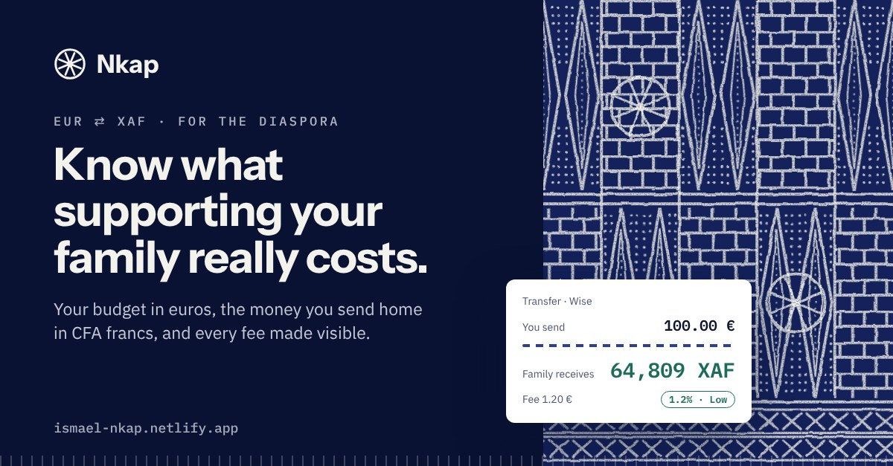
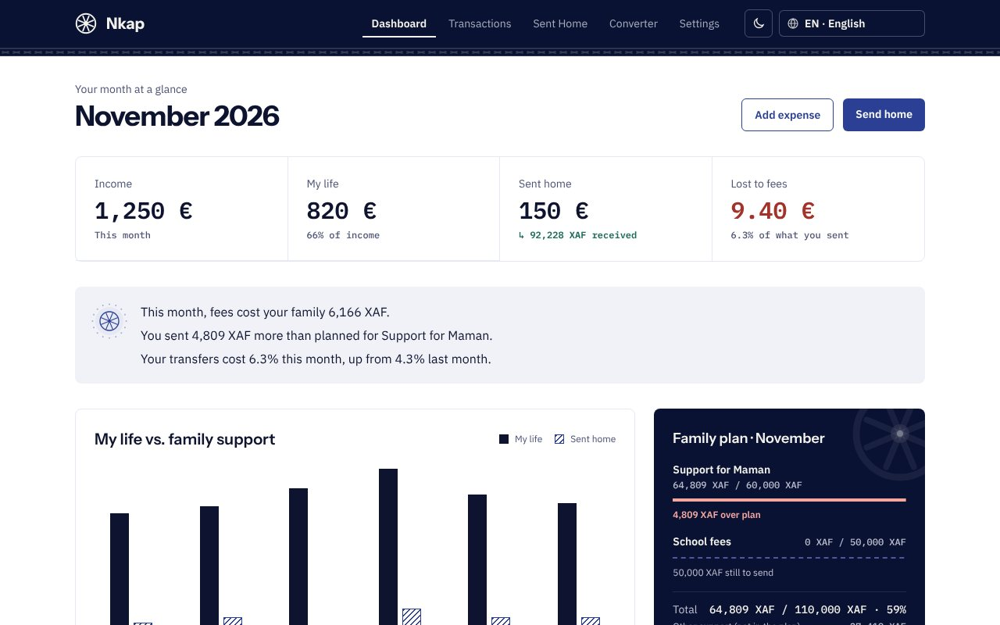
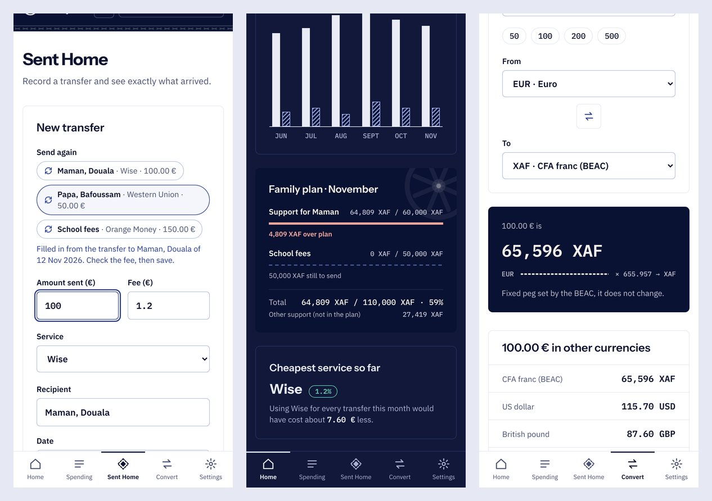
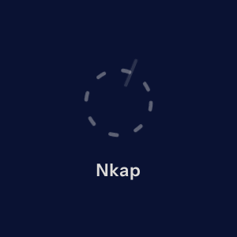

# Nkap

**Know what supporting your family really costs.**

[](https://github.com/letschangeAfrica/nkap/actions/workflows/ci.yml)

Nkap is a free personal-finance app for the African diaspora in Europe. It puts your budget in euros and the money you send home in CFA francs (XAF) side by side, makes the fee on every transfer visible, and helps you plan the support your family counts on.

**Live app: [ismael-nkap.netlify.app](https://ismael-nkap.netlify.app)** · No account · Works offline · English, French and Cameroonian Pidgin

> ALX AI for Developers II · Front-End Capstone · Ismaël Ariel Kagou Manga



## Screenshots







## The problem, and how Nkap solves it

Cameroonian and other African students and workers in Europe send money home every month, for school fees, rent, health and emergencies. The World Bank reports sub-Saharan Africa as the most expensive region in the world to receive money: **8.46%** on average to send $200 ([Remittance Prices Worldwide, Q3 2025](https://remittanceprices.worldbank.org/)).

| Problem | What Nkap does |
|---|---|
| **Hidden fees.** People remember "I sent 100 €", not "I paid 7 € and my family got 61,000 XAF". | Every transfer shows what arrived in XAF and its cost in percent, with a Low / Medium / High badge. The dashboard turns the month's fees into XAF lost ("fees cost your family 6,166 XAF") and names the cheapest service you've used, with what you'd have saved. |
| **No overall view.** The budget is in a bank app, transfers in each service or in WhatsApp. | One dashboard: income, "my life" spending, money sent home and fees, plus a 6-month chart of my life vs. family support. |
| **Two currencies.** Spending is in EUR, family needs are in XAF. | Exact EUR ⇄ XAF on the fixed peg everywhere, even offline, plus a converter for USD, GBP, CAD, CHF and CNY. |
| **No planning.** Recurring support arrives as a surprise that breaks the budget. | Family commitments (e.g. 50,000 XAF a month for school fees). Each transfer can count towards one; the dashboard shows progress per commitment, what's left to send, and warns when you go over plan. |

## Features

| Page | What you can do |
|---|---|
| **Landing** | Try a live fee calculator, watch a 12-second demo, see the World Bank figure. Opens the app with no sign-up. |
| **Dashboard** | Month totals, insight sentences, 6-month chart, family plan per commitment, cheapest service, recent activity. A 3-step welcome and one-click demo data on the first visit. |
| **Transactions** | Add, **edit** and delete income and expenses in EUR by category; monthly totals. |
| **Sent Home** | Record a transfer and see, while typing, what arrives in XAF and what it costs. **Send again** refills a recent transfer in one tap. Link it to a family commitment. Edit or delete any transfer. Average cost by service. |
| **Converter** | EUR ⇄ XAF on the peg, other currencies with live ECB rates. Falls back to the last saved rates, and says so. |
| **Settings** | Language, light/dark/system theme, install the app, family commitments, **backup file (save and restore)**, **CSV export** for Excel or Google Sheets, demo data, delete all data, diagnostic report. |

**Installable and offline.** Add Nkap to your phone's home screen from Settings. A service worker keeps the app on the device, so it opens without internet; only live exchange rates need a connection. When a new version is published, the app picks it up the next time it opens online, or shows "A new version of Nkap is ready · Reload" if it is already open.

**Languages.** English, French and Cameroonian Pidgin English (Kamtok). Numbers, money and dates follow the language: `92,228 XAF` in English, `92 228 FCFA` in French. The first visit follows the browser's language. The Pidgin text is a draft awaiting review by a native speaker. To add a language, copy `src/i18n/en.js`, translate it and add one line to `LANGUAGES` in `src/i18n/index.js`; a test fails if a key or `{placeholder}` is missing.

## How the money maths works

- The CFA franc (XAF) is pegged to the euro by the BEAC: **1 EUR = 655.957 XAF**. EUR ⇄ XAF is calculated locally and is always exact.
- The fee is taken from the amount sent: `received = (amount − fee) × 655.957`, rounded to the franc.
- Cost = `fee ÷ amount`. **Low** below 5%, **Medium** from 5% to below 10%, **High** from 10%.
- Other currencies use European Central Bank reference rates from the free [Frankfurter API](https://frankfurter.dev/v1/) (no key). The ECB doesn't publish XAF, so those conversions go through the euro. Rates are reused for an hour, then refreshed.

## Changes from the plan

The Part 1 plan was followed for the MVP; where something in it didn't help the user, I changed it and say why here.

| Planned (Part 1) | Built | Why |
|---|---|---|
| Recharts for the dashboard charts | Custom SVG/CSS charts | Lighter, accessible (text summary for screen readers), and compatible with the strict Content-Security-Policy. |
| `api.frankfurter.app` | `api.frankfurter.dev/v1` | Frankfurter's current official address. Same data, no key. |
| "Track how much has been paid against the plan" (one total) | Transfers linked to a commitment, progress per commitment, over/under-plan alerts | A single total hid which commitment was late or over. |
| Default-currency setting; a currency field on each transaction | Not built: everything is in EUR | Nkap is built around EUR → XAF. A UK or US version (GBP/USD → home currency) is a separate feature, not a setting. |
| Start date on commitments | Not built | Progress is tracked per month, so a start date added nothing. |
| CSV export (stretch goal) | CSV export **and** a backup file you can restore, with a reminder | With data only in the browser, a backup is what protects your history. |
| Over-plan alert, service comparison, French and English (stretch goals) | Done; Cameroonian Pidgin added | |
| Not planned | Edit, Send again, installable offline app, light/dark mode, welcome steps, insights, landing calculator and demo video, animated launch screen, link-preview card, security hardening | Each one either removes friction from manual entry, builds trust in the numbers, or makes the app usable on a phone without data. |
| Steady commits over three weeks | Built in an intensive sprint (12–14 Nov 2026) | Built with an AI coding assistant, as the AI for Developers II program teaches. I reviewed, ran and committed every change. |

## Quality

- **271 tests** (Vitest + Testing Library), **97% of lines covered**, plus Playwright end-to-end smoke tests on the production build.
- **Accessibility:** axe-core (WCAG 2.1 AA) finds 0 violations on every page, in light and dark mode. Labelled fields, errors announced to screen readers, full keyboard use, visible focus, a text summary for the chart, and every animation turned off when the user prefers reduced motion.
- **CI** on every push: tests with coverage, `npm audit`, build, end-to-end tests and a secret scan. A daily job checks the live site's security headers, pages and certificate.

## Privacy and security

- **No account, no server, no bank connection.** Data is stored only in the browser on your device. Nothing is sent anywhere; the only request is for exchange rates, and it carries no personal data. Fonts are self-hosted.
- **Strict security headers** (`public/_headers`): Content-Security-Policy with `script-src 'self'` and no inline code, `frame-ancestors 'none'`, HSTS, `X-Frame-Options`, `Cross-Origin-Opener-Policy` and `Cross-Origin-Resource-Policy`, `Referrer-Policy: no-referrer`, a locked-down `Permissions-Policy`.
- **Validated data everywhere:** forms, saved data when it's loaded back, restored backup files (size limit, unknown fields dropped, invalid records skipped) and exchange-rate responses (size limit, real dates only). CSV exports neutralise spreadsheet formulas.
- **Security review:** 10 audits (secrets, input validation, API and infrastructure, business logic, logging…) found 37 issues, none Critical or High. All are fixed except 4 accepted design risks with one root cause: no local lock or encryption, by design.
- **Supply chain:** GitHub Actions pinned to commit SHAs, Dependabot for npm and actions, `npm audit` in CI.
- **Limits:** data in the browser and backup files are **not encrypted**. Anyone with your unlocked device can read them, so don't use Nkap on a shared computer, and keep backup files somewhere private. **Settings → Delete all my data** erases everything.

## Tech stack

React 19 · Vite · React Router 7 · Zustand 5 (persisted to `localStorage`, synced across tabs) · Tailwind CSS v4 with light and dark design tokens · a home-made i18n layer (no dependency) · a service worker generated at build time · Vitest, Testing Library and Playwright · Netlify.

## Getting started

```bash
git clone https://github.com/letschangeAfrica/nkap.git
cd nkap
npm install
npm run dev            # http://localhost:5173
npm test               # watch mode (works from any terminal, including VS Code's c:\ path)
npm run test:run       # single run
npm run test:coverage
npm run build          # production build in dist/
npm run preview        # serves dist/ with the production security headers
npm run test:e2e       # Playwright on the production build (first: npx playwright install chromium)
```

## Project structure

```
src/
  pages/          one file per route
  components/     UI (forms, lists, charts, family plan, banners, Ndop motifs in ndop/)
  store/          Zustand stores (transactions, transfers, commitments) and cross-tab sync
  hooks/          animated numbers, exchange rates, in-view
  i18n/           en.js, fr.js, wes.js (Pidgin) and the t() helper
  theme/          light / dark / system
  utils/          money maths, rates API, stats, insights, backup, validation, demo data
  pwa.js          install prompt, service worker registration, update banner
  splash.js       hides the launch screen once the wheel is complete
  __tests__/      Vitest tests
sw/               service worker generator (used by vite.config.js)
scripts/          test runner and header parser
public/           _headers, _redirects, manifest, icons, splash.css, link-preview image
e2e/              Playwright smoke tests
docs/screenshots/ images used in this README
```

## Known limitations and roadmap

- **Manual entry.** There is no import from banks or transfer services. Send again and backups reduce the effort; CSV import is the next step.
- **One device.** There is no sync between devices; a backup file moves your data. Real sync would need accounts and a server, which Nkap avoids on purpose.
- **No local lock.** A passcode with encryption is designed but not built.
- **EUR only.** A version for the UK, US and Canada (sending GBP, USD or CAD) is planned.
- **Pidgin draft** to be reviewed by a native speaker.

## Design and credits

The visual language comes from **Ndop**, the indigo and white resist-dyed cloth of the Bamileke and Grassfields chiefdoms of Cameroon: long dotted diamonds, brick grids, the eight-spoke wheel (Nkap's logo) and the X border band are redrawn as original SVG, and used only in decorative areas so numbers stay readable. Numbers use IBM Plex Mono so amounts line up; headings use Instrument Sans.

- Exchange rates: [Frankfurter](https://frankfurter.dev/), with European Central Bank data
- Remittance cost data: [World Bank, Remittance Prices Worldwide](https://remittanceprices.worldbank.org/)
- Fonts: [Instrument Sans](https://fonts.google.com/specimen/Instrument+Sans) and [IBM Plex](https://www.ibm.com/plex/), self-hosted via Fontsource

Built by **Ismaël Ariel Kagou Manga** for the ALX AI for Developers II Front-End capstone.
